# GBook

An open-source Android eReader for EPUB and PDF, built with Kotlin and Jetpack Compose. It turns your books and highlights into Instagram-style posts you can scroll through to remember what you read.

**[Download the latest APK](https://github.com/Gsweya/eBook/releases/latest)** — open it on your phone and allow installing from your browser or file manager.

## Screenshots

<table>
  <tr>
    <td align="center">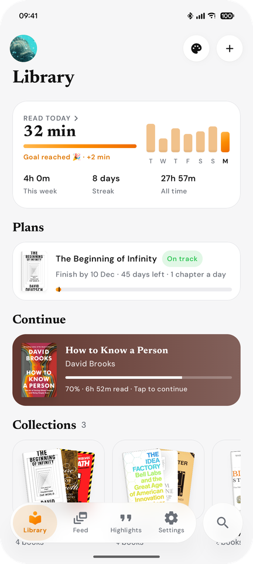<br><sub>Library and reading stats</sub></td>
    <td align="center">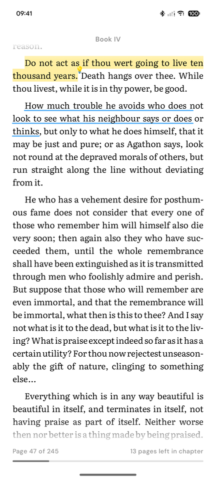<br><sub>Reader with highlights</sub></td>
    <td align="center">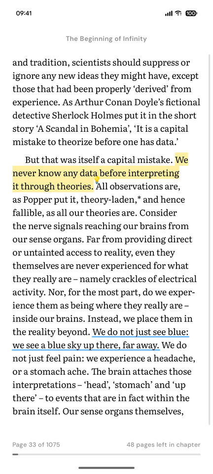<br><sub>Page-turn mode</sub></td>
    <td align="center">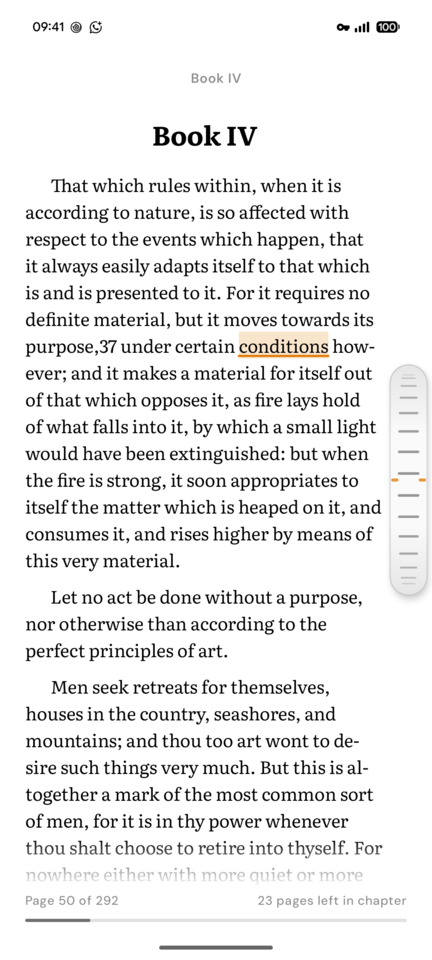<br><sub>Reading tracker</sub></td>
  </tr>
  <tr>
    <td align="center">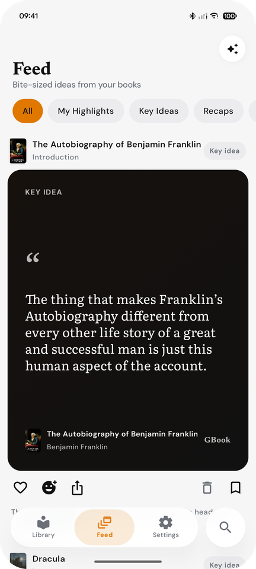<br><sub>Feed of posts</sub></td>
    <td align="center">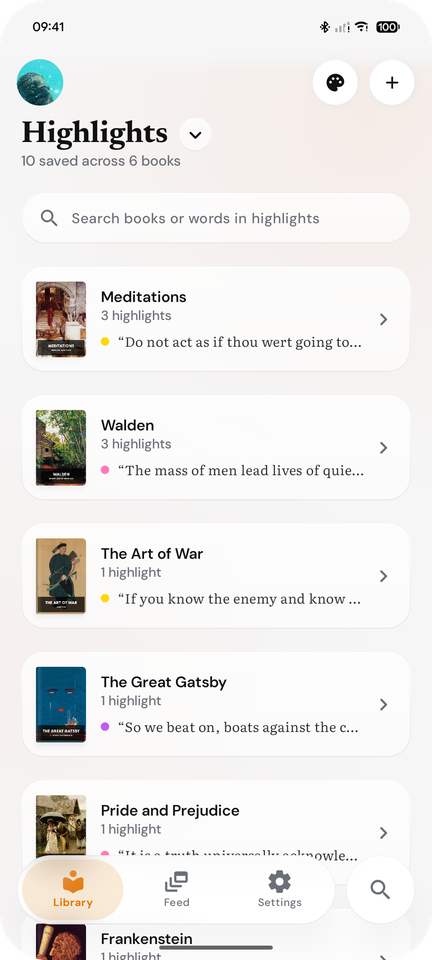<br><sub>Highlights</sub></td>
    <td align="center">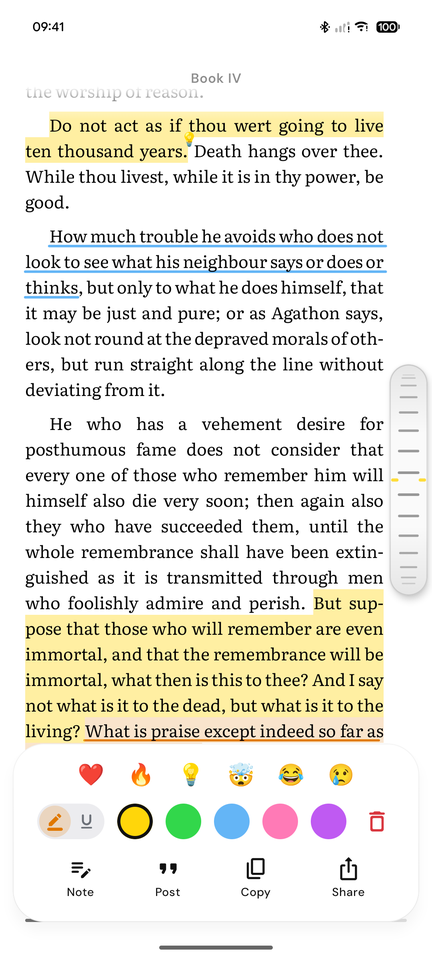<br><sub>Colours and reactions</sub></td>
    <td align="center">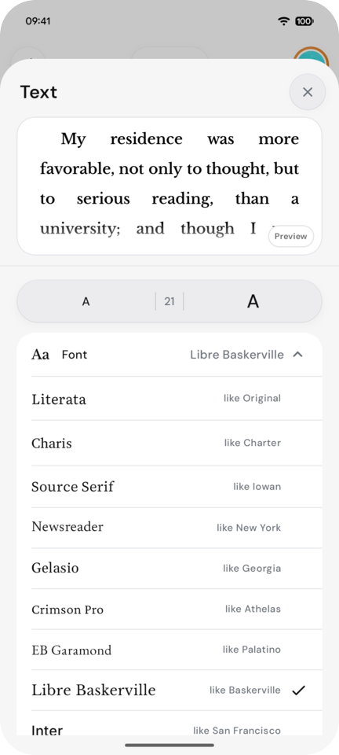<br><sub>Ten reading fonts</sub></td>
  </tr>
  <tr>
    <td align="center">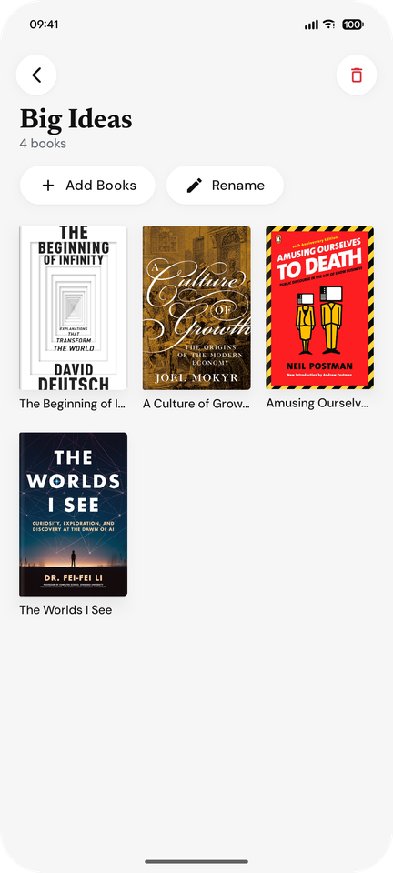<br><sub>Collections</sub></td>
    <td align="center">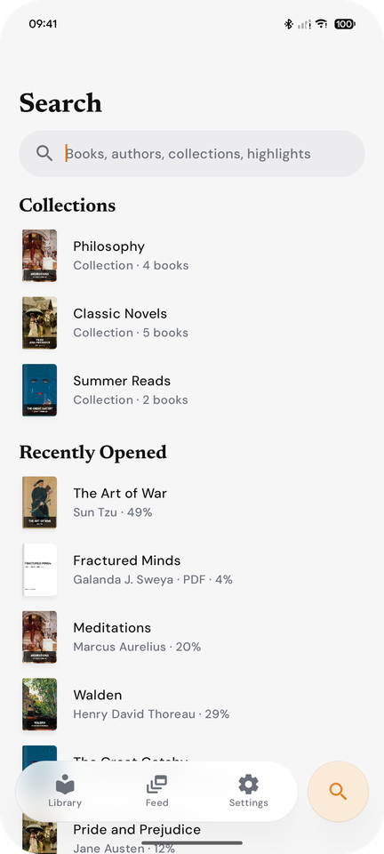<br><sub>Search</sub></td>
    <td align="center">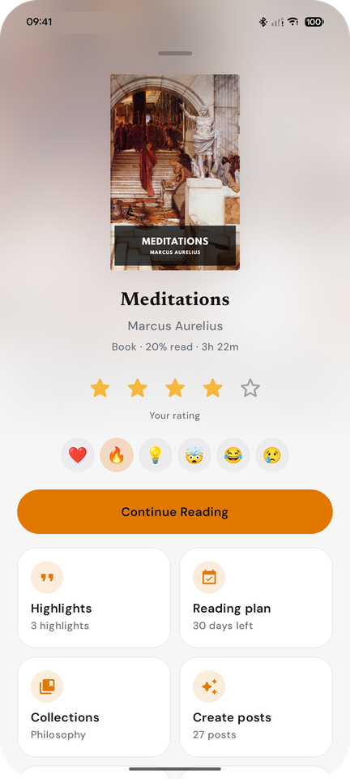<br><sub>Book page</sub></td>
    <td align="center">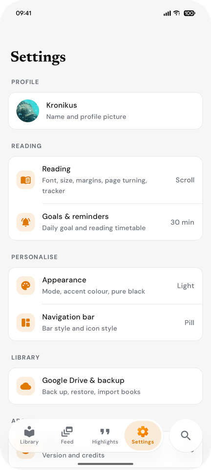<br><sub>Settings</sub></td>
  </tr>
  <tr>
    <td align="center">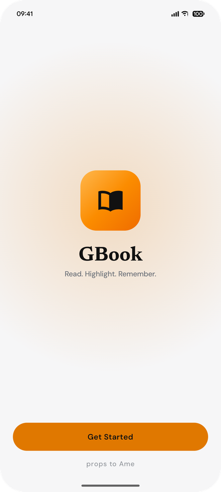<br><sub>Welcome</sub></td>
    <td align="center">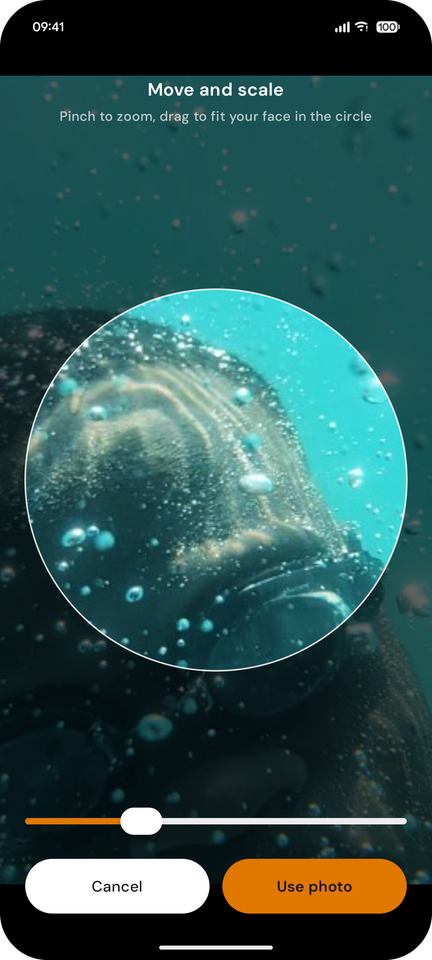<br><sub>Profile photo cropper</sub></td>
    <td align="center">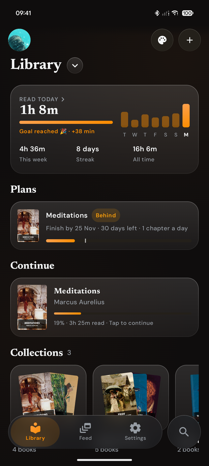<br><sub>Dark mode</sub></td>
    <td align="center">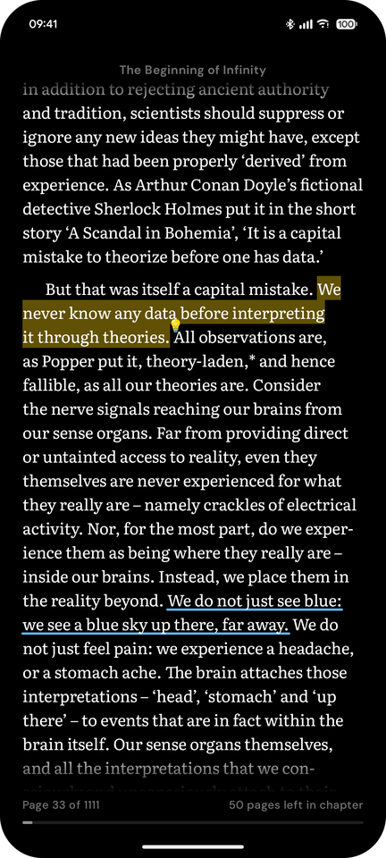<br><sub>Dark reader</sub></td>
  </tr>
</table>

## Features

- **Library** of EPUB and PDF books with covers, progress and reactions; add several books at once with the **+** button.
- **Collections**: select books and group them into named collections.
- **Search** tab for books, authors, collections and highlights.
- **First-run welcome**: a short splash, then set up your profile picture (with a circle cropper) and import your first books.
- **Reading time**: today's minutes, a 7-day chart, streak and all-time totals, plus time spent in each book.
- **Reader** with ten open-licence reading fonts (including Libre Baskerville), text size buttons and pinch-to-resize, page themes, line spacing, adjustable margins, contents and search.
- **Scroll or turn pages**: scroll through a whole chapter, or read one page at a time and tap or swipe to turn. Both show the page number, pages left in the chapter and a progress line.
- **Reading tracker**: turn the wheel on the right edge to move a marker through the text word by word or sentence by sentence.
- **Highlights** across paragraphs with drag handles, a lens loupe, and a marker or underline style.
- **Feed** of posts built on-device from chapter key ideas, recap carousels and your highlights.
- **PDF** page view with zoom, plus a reflowed text mode split by the PDF outline.
- **Make it yours**: accent palettes, light/dark/system mode, pure black, two bottom-bar styles with a separate search button, symbol or Noto 3D emoji icons, and a profile picture.
- **Google Drive** backup, restore and import through the system file picker.

## Build

Requires JDK 21 and the Android SDK (compileSdk 36).

```sh
cd gbook
./gradlew installDebug        # debug build on a connected phone
./gradlew assembleRelease     # release APK in app/build/outputs/apk/release/
```

Release signing uses a `gbook/keystore.properties` file (not committed) with `storeFile`, `storePassword`, `keyAlias` and `keyPassword`. Without it the release APK is built unsigned.

Debug builds also bundle any `.epub`/`.pdf` files you put in `sample_books/` (git-ignored); they are imported on first launch.

## Change how it looks

Everything visual lives in a few files under `gbook/app/src/main/java/com/gbook/ui/`:

| What | Where |
|---|---|
| Accent palettes, light/dark colours | `theme/Theme.kt` (`AccentPalettes`, `gColors`) |
| Reading fonts and the app font | `theme/Fonts.kt`, font files in `res/font/` |
| Buttons and surfaces | `components/Surfaces.kt` |
| Bottom bars (pill and classic) | `components/NavBar.kt` |
| Reader page themes | `theme/Theme.kt` (`ReaderThemes`) |
| Post card styles | `screens/FeedScreen.kt` |

Add a palette to `AccentPalettes` and it appears in **Settings → Appearance** automatically.

## Project layout

- `gbook/` — the Android app (`com.gbook`)
- `docs/spec.md`, `docs/spec-notes/` — design notes
- `bookgram-monorepo-structure.md` — original idea document

## Licences

GBook is released under the [MIT License](LICENSE). Bundled fonts are under the SIL Open Font License 1.1; the 3D icons are [Noto 3D Emoji](https://github.com/googlefonts/noto-emoji) under the Apache License 2.0.
