# GBook

An open-source Android eReader for EPUB and PDF, built with Kotlin and Jetpack Compose. It turns your books and highlights into Instagram-style posts you can scroll through to remember what you read.

**[Download the latest APK](https://github.com/Gsweya/eBook/releases/latest)** — open it on your phone and allow installing from your browser or file manager.

## Screenshots

<table>
  <tr>
    <td align="center"><br><sub>Library and reading stats</sub></td>
    <td align="center">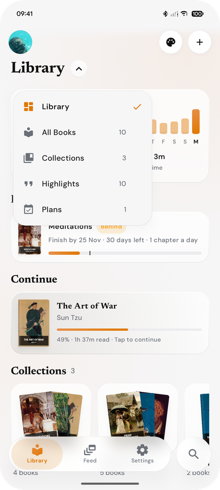<br><sub>Library views</sub></td>
    <td align="center"><br><sub>Book page and rating</sub></td>
    <td align="center">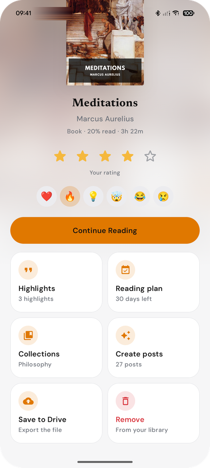<br><sub>Book options</sub></td>
  </tr>
  <tr>
    <td align="center"><br><sub>Reader with highlights</sub></td>
    <td align="center">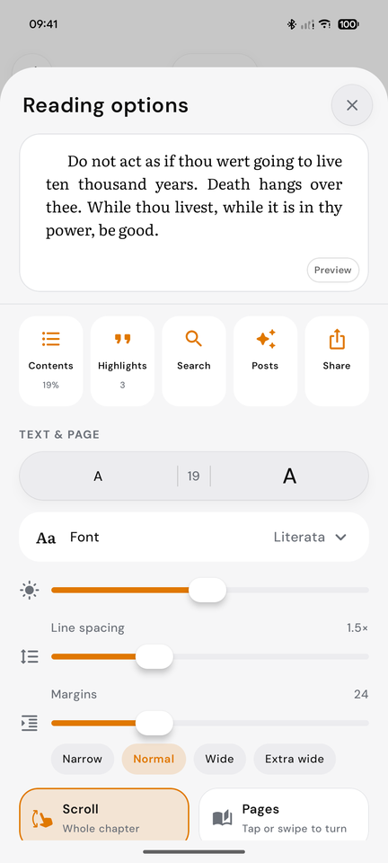<br><sub>Reading options with live preview</sub></td>
    <td align="center"><br><sub>Page-turn mode</sub></td>
    <td align="center"><br><sub>Ten reading fonts</sub></td>
  </tr>
  <tr>
    <td align="center"><br><sub>Reading tracker</sub></td>
    <td align="center">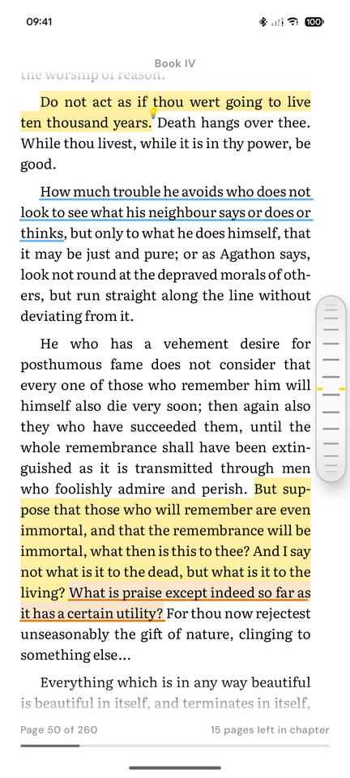<br><sub>Highlight with the wheel</sub></td>
    <td align="center">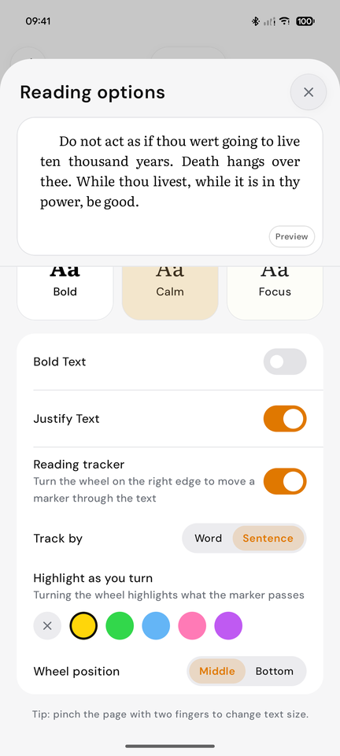<br><sub>Tracker options</sub></td>
    <td align="center"><br><sub>Colours and reactions</sub></td>
  </tr>
  <tr>
    <td align="center"><br><sub>Highlights by book</sub></td>
    <td align="center">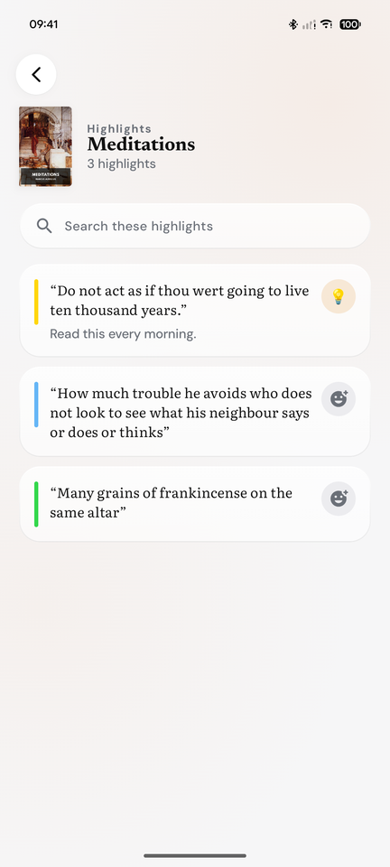<br><sub>A book's highlights</sub></td>
    <td align="center"><br><sub>Feed of posts</sub></td>
    <td align="center"><br><sub>Collections</sub></td>
  </tr>
  <tr>
    <td align="center"><br><sub>Search</sub></td>
    <td align="center"><br><sub>Settings</sub></td>
    <td align="center"><br><sub>Dark mode</sub></td>
    <td align="center"><br><sub>Dark reader</sub></td>
  </tr>
  <tr>
    <td align="center"><br><sub>Welcome</sub></td>
    <td align="center"><br><sub>Profile photo cropper</sub></td>
  </tr>
</table>

## Features

- **Starts with a free book**: *Fractured Minds* by Galanda J. Sweya ships with the app, so there's something to read right away.
- **Library** of EPUB and PDF books with covers, progress and reactions; add several books at once with the **+** button. A menu under the title switches between the overview, all books, collections, highlights and reading plans.
- **Book page**: a full-screen sheet over the blurred cover with a star rating, reactions, and cards for highlights, reading plan, collections, posts, Drive export and removal.
- **Collections**: select books and group them into named collections.
- **Search** tab for books, authors, collections and highlights.
- **First-run welcome**: a short splash, then set up your profile picture (with a circle cropper) and import your first books.
- **Reading time**: today's minutes, a 7-day chart, streak and all-time totals, plus time spent in each book.
- **Reader** with ten open-licence reading fonts (including Libre Baskerville), text size buttons and pinch-to-resize, page themes, line spacing, adjustable margins, contents and search, all in one **Reading options** sheet with a live preview of the page you're on.
- **Scroll or turn pages**: scroll through a whole chapter, or read one page at a time and tap or swipe to turn. Both show the page number, pages left in the chapter and a progress line.
- **Reading tracker**: turn the wheel on the right edge to move a marker through the text word by word or sentence by sentence. Pick a highlight colour in its options and turning the wheel highlights what the marker passes. The wheel can sit in the middle or at the bottom of the screen.
- **Highlights** across paragraphs with drag handles, a lens loupe, and a marker or underline style, grouped by book in the Library and searchable by book or wording.
- **Feed** of posts built on-device from chapter key ideas, recap carousels and your highlights.
- **PDF** page view with zoom, plus a reflowed text mode that reads like an EPUB: paragraphs, headings and named chapters are rebuilt from the page layout, and running headers and page numbers are dropped.
- **Make it yours**: accent palettes, light/dark/system mode, pure black, two bottom-bar styles with a separate search button, symbol or Noto 3D emoji icons, and a profile picture.
- **Google Drive** backup, restore and import through the system file picker.

## Build

Requires JDK 21 and the Android SDK (compileSdk 36).

```sh
cd gbook
./gradlew installDebug        # debug build on a connected phone
./gradlew assembleRelease     # release APK in app/build/outputs/apk/release/
```

Release signing uses a `gbook/keystore.properties` file (not committed) with `storeFile`, `storePassword`, `keyAlias` and `keyPassword`. Without it the release APK is built unsigned.

Debug builds also bundle any `.epub`/`.pdf` files you put in `sample_books/` (git-ignored); they are imported on first launch.

## Desktop app (Linux and Windows)

`desktop/` is a native GTK 4 app in Rust with the same look and features as the phone: Library with reading stats, plans and collections, the EPUB reader with highlights, notes, reactions and the focus tracker, the Feed, Search, Settings and PDF page view. Wide windows get a sidebar like Apple Books on the Mac; narrow ones switch to the phone's layout and pill bar. The window has rounded corners and its own window buttons. It reads and writes the same `library.json` and backup `.zip` as Android, so a phone backup restores on the desktop and the other way round. Data lives in `~/.local/share/gbook`.

<table>
  <tr>
    <td>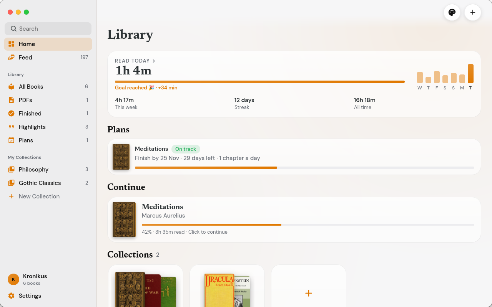</td>
    <td>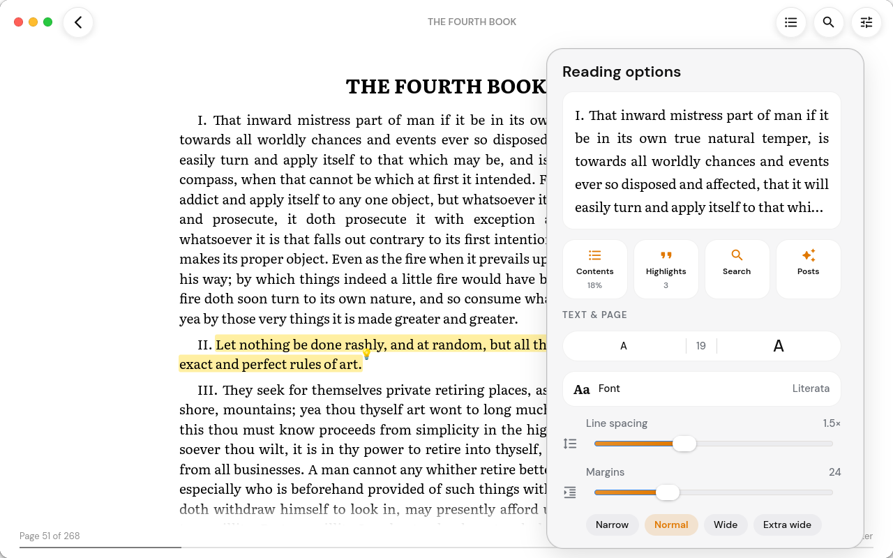</td>
  </tr>
  <tr>
    <td>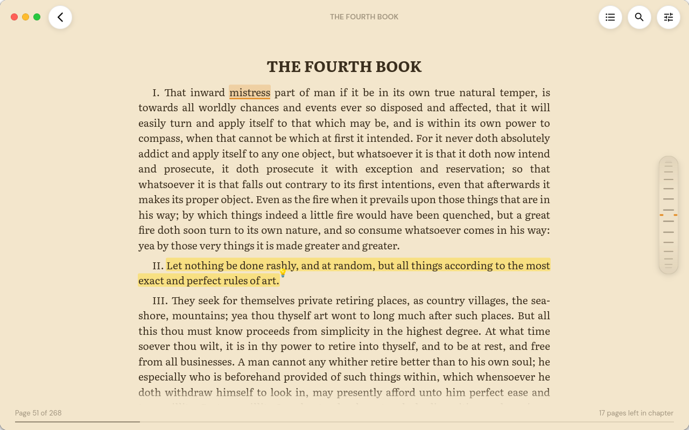</td>
    <td>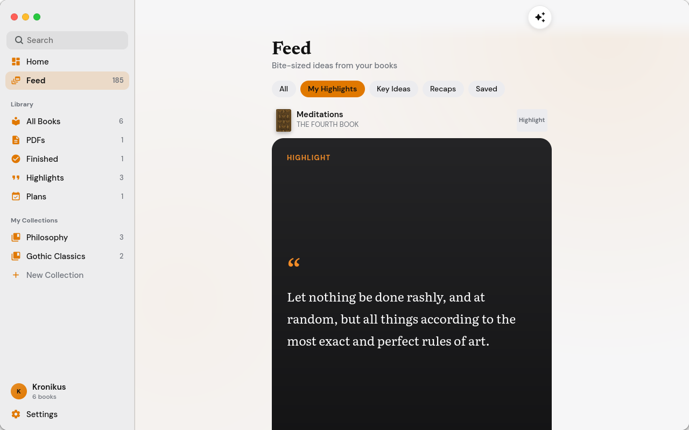</td>
  </tr>
  <tr>
    <td>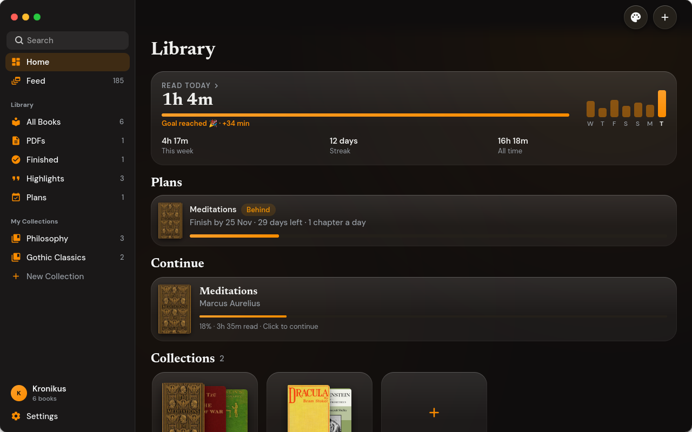</td>
    <td>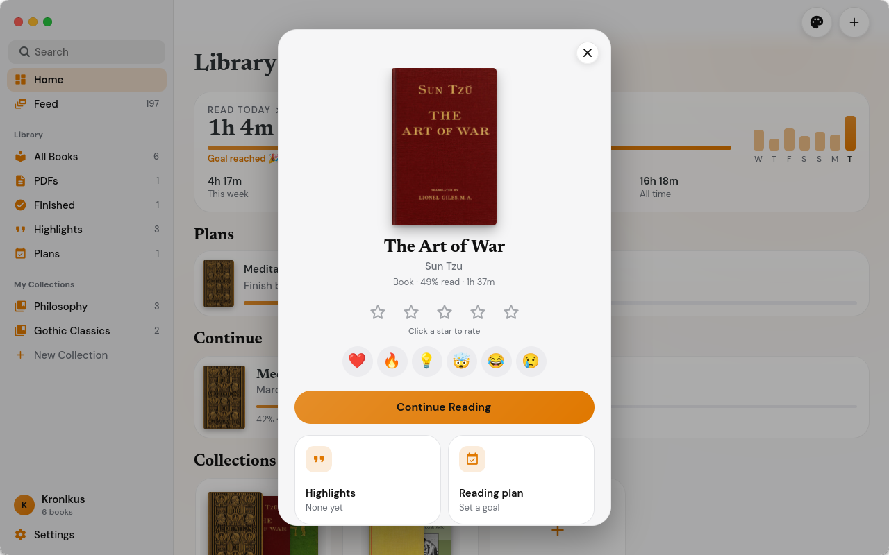</td>
  </tr>
</table>

It's built to stay light: a 1.6 MB binary that uses the GTK, Pango and Poppler already on a GNOME desktop, about 250 ms to the first frame with 100 books, and 110–150 MB of memory while reading.

Requires Rust, GTK 4.14+ and Poppler development files (`sudo dnf install gtk4-devel poppler-glib-devel` or `sudo apt install libgtk-4-dev libpoppler-glib-dev`).

```sh
cd desktop
cargo run --release                       # run from the source tree
./packaging/build-packages.sh             # dist/gbook_<version>_amd64.deb and dist/gbook-<version>-1.x86_64.rpm
sudo ./packaging/install.sh /usr/local    # or install without a package
```

Keyboard: arrows, Space and Page Up/Down turn pages; `[` and `]` change chapter; Ctrl + / Ctrl − change the text size; Ctrl+F searches; Ctrl+T opens the contents; `.` and `,` move the focus tracker; F11 is full screen; Esc goes back.

Windows builds use MSYS2 and an Inno Setup installer; see [docs/windows.md](docs/windows.md). The *Desktop packages* GitHub workflow builds the Windows installer and the Linux packages, and attaches them to `desktop-v*` releases. Books can be added with the + button, Ctrl+O, by dropping files on the window, or by opening them from the file manager.

For UI work, `GBOOK_DEV` runs a script of steps and saves snapshots of the window, e.g. `GBOOK_DEV="open:first; wait:800; shot:/tmp/reader.png; quit" cargo run`; see `desktop/app/src/devtools.rs`. `GBOOK_DATA_DIR` points the app at another library folder.

## Change how it looks

Everything visual lives in a few files under `gbook/app/src/main/java/com/gbook/ui/`:

| What | Where |
|---|---|
| Accent palettes, light/dark colours | `theme/Theme.kt` (`AccentPalettes`, `gColors`) |
| Reading fonts and the app font | `theme/Fonts.kt`, font files in `res/font/` |
| Buttons and surfaces | `components/Surfaces.kt` |
| Bottom bars (pill and classic) | `components/NavBar.kt` |
| Reader page themes | `theme/Theme.kt` (`ReaderThemes`) |
| Post card styles | `screens/FeedScreen.kt` |

Add a palette to `AccentPalettes` and it appears in **Settings → Appearance** automatically.

## Project layout

- `gbook/` — the Android app (`com.gbook`)
- `desktop/` — the Linux app: `core/` (library format, EPUB parser, feed posts, backups; no UI) and `app/` (GTK 4)
- `docs/spec.md`, `docs/spec-notes/` — design notes
- `bookgram-monorepo-structure.md` — original idea document

## Licences

GBook is released under the [MIT License](LICENSE). Bundled fonts are under the SIL Open Font License 1.1; the 3D icons are [Noto 3D Emoji](https://github.com/googlefonts/noto-emoji) under the Apache License 2.0. The desktop app's icons are [Material Icons](https://github.com/google/material-design-icons) (Apache License 2.0), and it renders PDFs with the system's [Poppler](https://poppler.freedesktop.org/) library (GPL).
